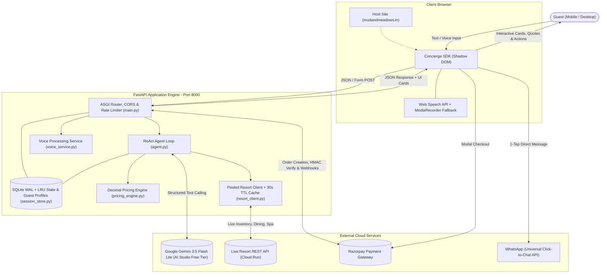
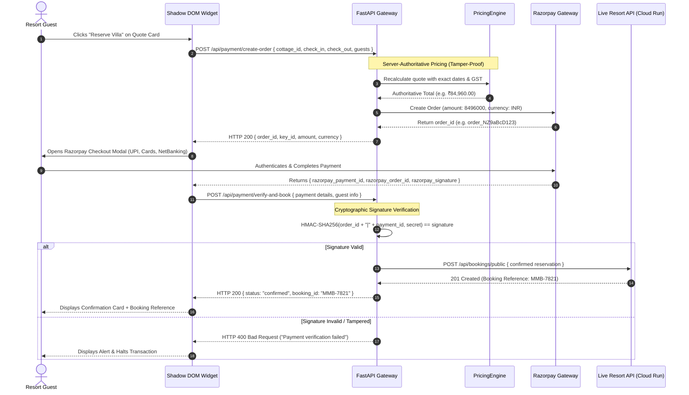

# Mud & Meadows Resort — Autonomous Concierge Engine

[](https://fastapi.tiangolo.com)
[](https://python.org)
[](https://aistudio.google.com/)
[](https://www.docker.com/)
[](https://razorpay.com/)
[](#operating-cost-breakdown)
[](LICENSE)

An autonomous AI Concierge chatbot engineered for **Mud & Meadows Resort** ([mudandmeadows.in](https://mudandmeadows.in/)).

Integrated directly with the resort's Cloud Run REST backend, this system handles real-time villa inventory discovery, deterministic multi-room pricing calculations with exact Indian GST tax slabs, 1-tap WhatsApp quotation dispatch, and in-chat room reservations powered by Razorpay. Built to operate at **$0.00 ongoing software cost** using Google Gemini free tier quotas and standard client protocols.

---

## Table of Contents

- [Overview & Business Context](#overview--business-context)
- [Architecture: ReAct Agent vs. Static Vector RAG](#architecture-react-agent-vs-static-vector-rag)
- [System Architecture](#system-architecture)
- [In-Chat Payment Processing & Security Lifecycle](#in-chat-payment-processing--security-lifecycle)
  - [Transaction Sequence Diagram](#transaction-sequence-diagram)
  - [Payment Failure Modes & Engineering Safeguards](#payment-failure-modes--engineering-safeguards)
- [WhatsApp Quotation Dispatch Protocol](#whatsapp-quotation-dispatch-protocol)
- [Deterministic Financial Pricing Engine](#deterministic-financial-pricing-engine)
- [Client SDK & Shadow DOM Encapsulation](#client-sdk--shadow-dom-encapsulation)
- [Repository File Structure & Module Responsibilities](#repository-file-structure--module-responsibilities)
- [Operating Cost Breakdown](#operating-cost-breakdown)
- [Live Resort API Integration](#live-resort-api-integration)
- [API Specifications & Endpoints](#api-specifications--endpoints)
- [Environment Configuration](#environment-configuration)
- [Local Quickstart & Development](#local-quickstart--development)
- [Docker & Containerized Execution](#docker--containerized-execution)
- [Cloud Deployment (AWS Free Tier)](#cloud-deployment-aws-free-tier)
- [Technical Evaluation & Resume Framing](#technical-evaluation--resume-framing)
- [License](#license)

---

## Overview & Business Context

Traditional hospitality booking widgets present several operational bottlenecks:
- **Rigid Date Pickers**: Difficult for multi-family bookings requiring multiple cottages or non-standard guest occupancy.
- **LLM Arithmetic Hallucinations**: Standard LLMs cannot reliably multiply nights, calculate extra bedding rates, or handle tiered tax structures.
- **Stale Knowledge**: FAQ bots powered by static document indexes frequently provide outdated prices and out-of-stock villa options.
- **Premature Upselling**: Aggressive payment prompts interrupt the guest discovery flow before trust is established.

### Engineering Objectives:
1. **Zero Hallucination Pricing**: Delegate all calendar math and tax computations to an auditable, deterministic Python service.
2. **Autonomous Multi-Turn Tool Execution**: Support multi-step discovery chains (e.g., query room capacity -> inspect layouts -> calculate quotes with 18% GST -> render interactive UI cards).
3. **In-Chat Checkout**: Enable guests to review quotes, forward summaries to WhatsApp with a single tap, and complete Razorpay reservations directly inside the chat interface.
4. **Style-Isolated Client SDK**: Embed into any parent website via a single `<script>` tag using Shadow DOM encapsulation to prevent CSS collisions.
5. **Zero Infrastructure Cost**: Architect the entire runtime to operate sustainably within free tier service allowances.

---

## Architecture: ReAct Agent vs. Static Vector RAG

Most conversational implementations default to **Retrieval-Augmented Generation (RAG)**: embedding document chunks into a vector store (e.g., Pinecone, ChromaDB) and performing similarity searches. In hospitality operations, RAG introduces significant drawbacks:

| Dimension | Static Vector RAG | Autonomous ReAct Agent (This System) |
| :--- | :--- | :--- |
| **Inventory Freshness** | Stale. Requires background indexing pipelines when room rates or availability change. | **Real-Time**. Interrogates the resort's Cloud Run REST backend directly on every request. |
| **Arithmetic Precision** | **Unreliable**. LLMs hallucinate multiplication across dates, extra beds, and tiered tax brackets. | **Deterministic**. Calculations are executed by `pricing_engine.py` under Indian GST law. |
| **Transactional Agency** | **Read-Only**. Capable only of document summarization; cannot create payment orders or book rooms. | **Action-Oriented**. Dispatches API calls to create Razorpay orders, generate quotes, and commit reservations. |
| **Complex Problem Solving** | Single-hop similarity match. Fails when a guest's request requires chained queries across multiple endpoints. | **Multi-Turn Reasoning**. Evaluates tool outputs across up to 4 autonomous iterations before replying. |
| **Infrastructure Overhead** | High. Requires vector databases, embedding endpoints, chunking pipelines, and synchronization workers. | **Zero Vector DB Cost**. Communicates directly over standard HTTP with existing backend services. |

---

## System Architecture

### Component Topology



---

## In-Chat Payment Processing & Security Lifecycle

When a guest books a room directly inside the chat interface, transactions must be protected against tampering, duplicate charges, and client drop-offs.

### Transaction Sequence Diagram



---

### Payment Failure Modes & Engineering Safeguards

| Failure Mode | Root Cause | Engineering Mitigation |
| :--- | :--- | :--- |
| **Client-Side Drop-Off** | A guest completes payment in their UPI app, but closes the browser or loses connectivity before the frontend callback triggers `/api/payment/verify-and-book`. | **Razorpay Webhooks (`POST /api/payment/webhook`)**: Razorpay's infrastructure dispatches signed asynchronous webhooks (`order.paid`, `payment.captured`) directly to our server, finalizing the reservation regardless of browser state. |
| **Concurrent Double-Booking** | Two guests attempt to pay for the last available cottage for the same dates simultaneously. | **Inventory TTL Locks & Automated Refunds**: When an order is generated, an inventory hold (10-minute TTL) is placed on the cottage dates. If a race condition bypasses the lock, the backend triggers an instant refund via Razorpay's Refund API. |
| **Client-Side Price Tampering** | An attacker edits the frontend payload to send `amount: 1` (₹1) instead of the actual price. | **Server-Authoritative Order Creation**: The client never supplies the price. The frontend transmits room parameters (`cottage_id`, `check_in`, `check_out`, `guests`); the server fetches base tariffs and computes the order total internally. |
| **Duplicate Retries** | Network packet drops on mobile devices cause repeated taps on the checkout trigger. | **Idempotency Keys**: Order requests are keyed by `session_id + cottage_id + check_in`. Duplicate requests within a 15-minute window return the existing `order_id` rather than generating a new transaction. |
| **Signature Forgery** | An adversary submits fabricated transaction identifiers to spoof a successful booking. | **Constant-Time HMAC-SHA256 Verification**: Signatures are validated using constant-time comparison against the merchant secret key before invoking the resort booking endpoint. |

---

## WhatsApp Quotation Dispatch Protocol

To eliminate enterprise messaging API overhead (such as Meta Business API or Twilio conversation pricing), the system implements a **Universal WhatsApp Click-to-Chat Protocol**:

1. When a quotation is generated, the agent compiles room specifications, dates, occupancy, and the itemized tax breakdown.
2. The payload is encoded into an RFC 3986 deep link:
   ```
   https://api.whatsapp.com/send?text=MUD%20%26%20MEADOWS%20RESORT...
   ```
3. Clicking **"Share on WhatsApp"** opens WhatsApp natively on mobile or WhatsApp Web on desktop with the message pre-staged, allowing the guest to forward it to family members or the reservations team at zero messaging cost.

---

## Deterministic Financial Pricing Engine

Under Indian hospitality tax regulations, hotel room GST is tiered by declared room tariff:
* **Tariff ≤ ₹7,500/night**: 12% GST
* **Tariff > ₹7,500/night**: 18% GST

The [`PricingEngine`](file:///c:/Users/adars/Desktop/chatbot-for-company/pricing_engine.py) computes auditable financial breakdowns:

$$\text{Base Rent} = \text{Price Per Night} \times \text{Nights}$$

$$\text{Extra Bedding} = \text{Extra Beds} \times ₹1,500 \times \text{Nights}$$

$$\text{Subtotal} = \text{Base Rent} + \text{Extra Bedding} + \text{Add-Ons} - \text{Discount}$$

$$\text{GST Amount} = \text{Subtotal} \times \text{Tax Rate (12\% or 18\%)}$$

$$\text{Grand Total} = \text{Subtotal} + \text{GST Amount}$$

---

## Client SDK & Shadow DOM Encapsulation

To embed the concierge chatbot onto `https://mudandmeadows.in/` (or any CMS including WordPress, Webflow, Shopify, or React) without stylesheet interference:

### Single-Line Embed Script
Include this tag immediately prior to the closing `</body>` tag:
```html
<script 
  src="https://your-domain.com/static/widget.js" 
  data-api-base="https://your-domain.com"
  async>
</script>
```

### Architectural Benefits of Shadow DOM:
* **CSS Scope Isolation**: Global styles from the parent website cannot alter the widget's typography, input fields, or layout cards.
* **Namespace Protection**: Internal class names and DOM nodes remain inaccessible to third-party scripts on the host page.
* **Zero Dependency Footprint**: Pure vanilla JavaScript (ES6+), avoiding heavy framework runtimes (~25 KB unminified).

---

## Repository File Structure & Module Responsibilities

```
├── config.py                  # Pydantic Settings singleton; CORS whitelist, rate limit & TTL config
├── session_store.py           # Zero-cost SQLite WAL + bounded LRU store, idempotency, rate limiter
├── resort_client.py           # Persistent HTTP connection pool + 30s TTL read-through catalog cache
├── pricing_engine.py          # Deterministic Decimal (ROUND_HALF_UP) calculator for GST & tariffs
├── voice_service.py           # Speech processing service (Web Speech API + backend Whisper/Gemini)
├── notification_service.py    # Universal WhatsApp Click-to-Chat deep link generator
├── agent.py                   # Multi-turn ReAct loop, context window pruning, authenticated PII lookup
├── main.py                    # FastAPI gateway, server-authoritative checkout, Razorpay webhooks
├── static/
│   ├── widget.js              # Shadow DOM SDK, inline guest forms (XSS-safe), Razorpay modal
│   ├── widget.css             # Earth-toned resort UI theme isolated within the Shadow Root
│   └── index.html             # Host page test harness for local development
├── docs/
│   └── PROJECT_SUMMARY.md     # In-depth architectural analysis and production summary
├── Dockerfile                 # Multi-stage production container build with rootless user
├── docker-compose.yml         # Container orchestration configuration
└── deploy_aws.sh              # Automated provisioning script for AWS EC2 / App Runner
```

---

## Operating Cost Breakdown

| Layer | Technology / Service | Pricing Model | Monthly Software Cost |
| :--- | :--- | :--- | :--- |
| **LLM Intelligence** | Google Gemini 3.5 Flash Lite | Google AI Studio Free Tier | **$0.00** |
| **Voice Processing** | Web Speech API (en-IN) + Groq Whisper fallback | Native Browser + Free Tier | **$0.00** |
| **Session & Idempotency** | SQLite (WAL mode) + In-Memory LRU Cache | Built-in Python Stdlib | **$0.00** |
| **Rate Limiting** | Sliding-Window Token/IP Bucket | Built-in Python Stdlib | **$0.00** |
| **Messaging** | WhatsApp Click-to-Chat (RFC 3986) | Open URL Deep-Link Protocol | **$0.00** |
| **Hosting** | AWS EC2 (`t2.micro` / `t3.micro`) | AWS Free Tier (750 hrs/mo) | **$0.00** |

---

## Live Resort API Integration

The concierge interfaces with the resort's Cloud Run backend:
* **Base URL**: `https://mudandmeadows-api-742259178550.asia-south1.run.app`
* **Specification**: `/docs` (OpenAPI Swagger)

### Synced Endpoints:
1. `GET /api/cottages/`: Real-time inventory, baseline rates, and occupancy thresholds.
2. `GET /api/cottages/{id}`: Cottage specifications, bedding arrangements, and amenity lists.
3. `GET /api/dining/all`: Restaurant menus, dining specials, and dietary indicators.
4. `GET /api/wellness/programs`: Ayurvedic treatments, wellness programs, and schedules.
5. `GET /api/experiences/`: Outdoor activities, nature excursions, and resort experiences.
6. `POST /api/coupons/quote`: Promotional coupon validation and discount computation.
7. `POST /api/bookings/public`: Reservation commit into the central property management system.

---

## API Specifications & Endpoints

### 1. `POST /api/chat`
Dispatches guest natural language input to the ReAct reasoning loop.
* **Request**:
  ```json
  {
    "message": "calculate cost for 4 guests for 2 nights in your luxury villa",
    "session_id": "session_abc123"
  }
  ```
* **Response**:
  ```json
  {
    "text": "For 4 guests staying 2 nights, The Rajasthan Family Villa offers spacious luxury...",
    "cards": [
      {
        "type": "quote_card",
        "quote": {
          "cottage_name": "The Rajasthan Family Villa",
          "nights": 2,
          "base_room_rent": 48000.0,
          "gst_percent": 18.0,
          "gst_amount": 8640.0,
          "grand_total": 56640.0
        }
      }
    ],
    "action": "SHOW_QUOTE"
  }
  ```

### 2. `GET /api/chat/history` & `POST /api/guest/identify`
Supports returning-visitor continuity across page reloads and repeat visits. The client widget maintains an anonymous persistent identifier in `localStorage` (`mm_visitor_id`) instead of an upfront conversion-killing login wall, progressively binding optional guest profile preferences (name, email, phone) into SQLite `guest_profiles` when provided during quote or reservation interactions.

### 3. `POST /api/voice/process`
Accepts multipart audio blobs (`.webm`, `.wav`, `.mp3`) recorded by the widget's `MediaRecorder` fallback (for browsers lacking `SpeechRecognition` such as Safari iOS or Firefox), transcribes/translates regional speech via `voice_service.py` (Groq Whisper-Large-v3 / Gemini Multimodal), and routes the text directly into `agent.chat()`.

### 4. `POST /api/payment/create-order`
Creates an idempotent, server-authoritative Razorpay order using server-recalculated pricing (`cottage_id`, `check_in`, `check_out`). Ignores client-supplied totals and deduplicates duplicate retries for 15 minutes.

### 5. `POST /api/payment/verify-and-book`
Validates constant-time HMAC-SHA256 payment signatures and finalizes reservations idempotently.

### 6. `POST /api/payment/webhook`
Handles asynchronous server-to-server Razorpay `payment.captured` and `order.paid` webhook events using `X-Razorpay-Signature` cryptographic verification to recover bookings if a guest drops off before completing browser callbacks.

### 7. `GET /health`
Returns service availability, connected API endpoints, and environment status.

---

## Environment Configuration

Environment settings are managed through Pydantic in [`config.py`](file:///c:/Users/adars/Desktop/chatbot-for-company/config.py). Configure a `.env` file in the project root:

```ini
PORT=8000
ENVIRONMENT=development
COMPANY_NAME=Mud & Meadows
RESORT_API_BASE_URL=https://mudandmeadows-api-742259178550.asia-south1.run.app
GEMINI_API_KEY=your_gemini_api_key_from_ai_studio
RAZORPAY_KEY_ID=rzp_test_placeholder
RAZORPAY_KEY_SECRET=placeholder_secret
RAZORPAY_WEBHOOK_SECRET=your_webhook_secret
SESSION_DB_PATH=concierge_state.db
SESSION_TTL_SECONDS=1800
RATE_LIMIT_CHAT_RPM=12
RATE_LIMIT_PAYMENT_RPM=6
ALLOWED_ORIGINS=https://mudandmeadows.in,https://www.mudandmeadows.in,http://localhost:8000
```

---

## Local Quickstart & Development

### 1. Prerequisites
* Python 3.11+
* Gemini API Key from [Google AI Studio](https://aistudio.google.com/)

### 2. Setup
```bash
# Clone the repository
git clone https://github.com/adarsh2179/mudandmeadows-shruti-chatbot.git
cd mudandmeadows-shruti-chatbot

# Initialize virtual environment
python -m venv venv

# Activate virtual environment
# Windows:
venv\Scripts\activate
# Linux/macOS:
source venv/bin/activate

# Install dependencies
pip install -r requirements.txt

# Create environment configuration
cp .env.example .env
# Add your GEMINI_API_KEY inside .env
```

### 3. Run Development Server
```bash
python -m uvicorn main:app --host 0.0.0.0 --port 8000 --reload
```
Navigate to **[http://localhost:8000](http://localhost:8000)** to access the local development harness.

---

## Docker & Containerized Execution

### Docker Compose
```bash
# Build and run containers in background
docker compose up -d --build

# Inspect service logs
docker compose logs -f

# Verify service health
curl http://localhost:8000/health
```

---

## Cloud Deployment (AWS Free Tier)

Deploy to an **Ubuntu 22.04 LTS** EC2 instance (`t2.micro` or `t3.micro`):

```bash
# On the EC2 instance:
git clone https://github.com/adarsh2179/mudandmeadows-shruti-chatbot.git
cd mudandmeadows-shruti-chatbot
cp .env.example .env
# Edit .env with production credentials
chmod +x deploy_aws.sh
./deploy_aws.sh
```

---

## Technical Evaluation & Resume Framing

Key architectural contributions for technical interviews and resume highlights:

* **Engineered an autonomous conversational concierge** using Google Gemini 3.5 Flash Lite with a multi-turn ReAct execution loop, coordinating dynamic tool calls against production Cloud Run REST services.
* **Eliminated mathematical hallucinations** by architecting a deterministic Python financial engine handling multi-night stays, extra bedding logic, and statutory Indian GST tax brackets (12% vs. 18%).
* **Implemented an end-to-end payment workflow with Razorpay**, incorporating server-authoritative order generation, constant-time HMAC-SHA256 signature verification, and webhook-driven drop-off protection.
* **Built an embeddable client SDK using Shadow DOM web components**, achieving complete CSS scope isolation and zero namespace pollution on client websites.
* **Maintained zero infrastructure software expense ($0.00/month)** by leveraging Gemini free-tier quotas and standard browser protocols.

---

## License

Proprietary & Confidential — Engineered for **Mud & Meadows Resort** ([mudandmeadows.in](https://mudandmeadows.in/)). Open-source release under the [MIT License](LICENSE).
